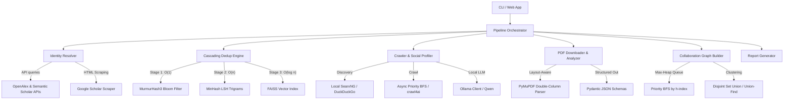

# 🔬 Research-the-Researcher

<div align="center">


**High-Performance, 100% Fully-Local OSINT Academic Intelligence Pipeline**  
Disambiguates profiles, cascades deduplication, parses full-text PDFs with local LLMs, and maps deep co-author collaboration networks.

Developed by [**Roshan Kumar Gupta** (@rk-roshan-kr)](https://github.com/rk-roshan-kr)

</div>

---

## 📌 Project Overview

**Research-the-Researcher** is an enterprise-grade, fully local Open Source Intelligence (OSINT) pipeline designed to autonomously aggregate, deduplicate, and analyze an academic researcher's entire online and academic footprint.

Given a simple query (researcher name, ORCID, Google Scholar URL, or Semantic Scholar ID), the system compiles their complete publication history, constructs an enriched co-author collaboration graph, parses PDF papers with local LLMs, and discovers their social profiles (LinkedIn, X, homepages).

### Core Philosophies:
1. **Zero External API Dependencies:** No paid API keys (OpenAI, Gemini), no arbitrary rate limits, and 100% data privacy. Everything from document parsing to Large Language Model inference runs entirely on your local machine.
2. **Hardware-Optimized Concurrency:** High-speed processing utilizing native `asyncio.Semaphore` pools, multithreaded OpenAlex querying, and async batching.
3. **Algorithmic Efficiency:** Bypasses brute-force bottlenecks using custom Data Structures & Algorithms (Bloom Filters, MinHash LSH, FAISS, Union-Find/DSU) to handle hundreds of thousands of academic records in milliseconds.

---

## 🧠 System Architecture



### Key Modules

* **Identity Resolution (`resolver.py`):** Disambiguates targets across OpenAlex, Semantic Scholar, and Google Scholar with interactive CLI resolution prompts when homonyms occur.
* **3-Stage Cascade Deduplication (`dedup_engine.py`):**
  1. *Stage 1 (O(1)):* 2M-bit Bloom Filter filters out exact DOI and ArXiv matches in nanoseconds.
  2. *Stage 2 (O(n)):* MinHash LSH tokenizes titles into trigrams to catch typos, capitalization, and minor edits ($\ge 0.85$ Jaccard similarity).
  3. *Stage 3 (O(log n)):* GPU/CPU FAISS Vector Index (`IndexFlatIP`) embeds ambiguous titles with `sentence-transformers/all-MiniLM-L6-v2` to catch paraphrased titles.
* **Co-Author Network Graphing (`collaboration_graph.py`):** Traverses collaborator networks up to depth 2 using a Max-Heap Priority Queue ($\text{Priority} = h\text{-index} \times \log(\text{citations} + 2)$) and Union-Find to group connected research clusters.
* **Local GPU Document Analysis (`pdf_analyzer.py`):** Streams PDFs via `aiohttp` with layout-aware double-column extraction, prompting local Ollama LLMs with Pydantic schemas for deterministic structured JSON output.
* **Two-Tier Resumable Cache (`cache_manager.py`):** In-memory LRU cache backed by SQLite in WAL (Write-Ahead Logging) mode, ensuring 100% resumable pipeline execution if interrupted.

---

## 🚦 Getting Started

### Prerequisites
* **Python 3.10+**
* **Ollama**: [Download Ollama](https://ollama.com/)
* **Docker Desktop**: (Optional, for local SearxNG metasearch)

### 1. Clone & Install
```bash
git clone https://github.com/rk-roshan-kr/Research-the-Researcher.git
cd Research-the-Researcher

# Create virtual environment
python -m venv venv
source venv/bin/activate  # On Windows: venv\Scripts\activate

# Install dependencies
python setup.py
```

### 2. Set Up Local LLM (Ollama)
Ensure the Ollama daemon is running, then pull the model:
```bash
ollama pull qwen2.5:14b
# Or lightweight alternative:
ollama pull qwen2.5:7b
```

### 3. Optional: Start Local SearxNG Metasearch
```bash
cd searxng
docker compose up -d
cd ..
```

---

## 🚀 Running the System

### Option A: Interactive Web UI (React + Flask)
Launch the full interactive visual dashboard:
```bash
python web_app.py
```
Open **`http://localhost:5000`** in your browser to search researchers, view real-time task logs, and inspect interactive collaboration graphs.

### Option B: High-Performance CLI
```bash
# Standard Run
python run.py --name "Demis Hassabis"

# Deep Run with Full PDF Analysis and Depth-2 Graph
python run.py --name "Yann LeCun" --deep-run --graph-depth 2 --max-coauthors 50

# Target by Semantic Scholar ID or ORCID
python run.py --id "1741101"
```

---

## 📁 Generated Outputs

All outputs are saved to the `outputs/` directory:
1. **`{name}_profile.json`**: Complete structured JSON dossier with metadata, citations, and LLM evaluations.
2. **`{name}_report.md`**: Publication-grade Markdown summary report.
3. **`{name}_report.html`**: Interactive HTML visualizer with an embedded, physics-based network graph of co-authors.

---

## 🧪 Testing

Run the test suite using `pytest`:
```bash
pytest tests/
```

---

## 🤝 Contributing

We welcome community contributions, algorithms improvements, and new academic source integrations!  
Please see our [Contributing Guide](CONTRIBUTING.md) for setup instructions and code standards.

---

## 📄 License

This project is licensed under the [MIT License](LICENSE) &copy; 2026 Roshan Kumar Gupta.
