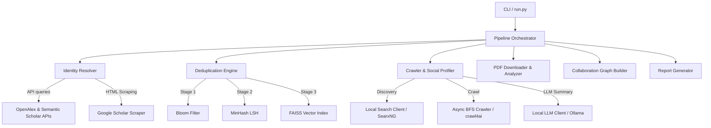

# Research-the-Researcher Codebase Analysis Report

This document presents a deep-dive analysis of the **Research-the-Researcher** repository, an enterprise-grade, 100% local Open Source Intelligence (OSINT) pipeline designed to aggregate, deduplicate, and analyze a researcher's academic and online footprint.

---

## 1. Project Objective & Core Philosophies
The primary objective of the codebase is to build a comprehensive, automated dossier of a researcher using a completely local technology stack:
* **Zero External API Dependencies:** Replaces paid search/LLM services (like OpenAI, Gemini) with local engines (Ollama running Qwen3:14B, self-hosted SearxNG Docker container, and DuckDuckGo fallback).
* **Hardware-Optimized Concurrency:** High-speed processing utilizing native `asyncio.Semaphore` pools to throttle concurrent requests to the local GPU without OS thread overhead.
* **Algorithmic Deduplication & Graph Traversals:** Utilizes custom Data Structures and Algorithms (DSAs) to eliminate rate limits, duplicate publications, and infinite graph traversal bugs.

---

## 2. System Architecture & Component Mapping

The repository consists of five core autonomous modules orchestrated by the master pipeline controller:



### 2.1 Identity Resolution & Aggregation
* **Files:** [resolver.py](file:///d:/Research-the-Researcher/academic_pipeline/resolver.py), [openalex.py](file:///d:/Research-the-Researcher/academic_pipeline/openalex.py), [semantic_scholar.py](file:///d:/Research-the-Researcher/academic_pipeline/semantic_scholar.py), [google_scholar.py](file:///d:/Research-the-Researcher/academic_pipeline/google_scholar.py)
* **Logic:** Disambiguates a target researcher by accepting names, ORCIDs, Google Scholar URLs, or Semantic Scholar IDs.
* **Key Mechanisms:**
  - Detects query type (regex-based checking).
  - Performs cross-referenced API queries to link different profile identifiers.
  - Features an **Interactive CLI selection table** using `rich` if multiple matches are found during a name search, allowing users to select the correct researcher.
  - Google Scholar scraping acts as a fallback or auxiliary source, parsing bibliometric stats ($h$-index, citations) and publication tables using `BeautifulSoup`.

### 2.2 Cascading Deduplication Engine
* **File:** [dedup_engine.py](file:///d:/Research-the-Researcher/academic_pipeline/dedup_engine.py)
* **Logic:** Eliminates publication duplicate bottlenecks (e.g., when a paper is retrieved from both OpenAlex and Semantic Scholar under slightly different titles) without incurring $O(n^2)$ pairwise comparison penalties.
* **Methodologies:**
  1. **Stage 1 (O(1)): Bloom Filter & Exact Hash:** MurmurHash3-based Bloom Filter filters out exact DOI/ArXiv ID matches in nanoseconds.
  2. **Stage 2 (O(n)): MinHash LSH (Locality-Sensitive Hashing):** Tokenizes titles into trigrams, creating MinHash signatures. Inserts signatures into an LSH index to match titles with Jaccard similarity $\ge 0.85$ (e.g., catching minor typos or differing punctuation).
  3. **Stage 3 (O(log n)): FAISS Semantic Index:** If the first two stages miss, titles are embedded using `sentence-transformers/all-MiniLM-L6-v2` and searched via a FAISS GPU/CPU index (IndexFlatIP) with a cosine similarity threshold of $0.95$.

### 2.3 Asynchronous Web Crawling & Discovery
* **Files:** [async_fetcher.py](file:///d:/Research-the-Researcher/academic_pipeline/async_fetcher.py), [local_search.py](file:///d:/Research-the-Researcher/academic_pipeline/local_search.py), [social_media.py](file:///d:/Research-the-Researcher/academic_pipeline/social_media.py)
* **Logic:** Discovers and scrapes professional/social profiles (LinkedIn, X/Twitter, and Personal Homepages).
* **Key Components:**
  - **LocalSearchClient:** Interfaces with a local **SearxNG** instance to find target URLs or falls back to **DuckDuckGo** scrapers if SearxNG is unavailable.
  - **TokenBucket:** Enforces per-domain rate limits (e.g., 1 request per 2 seconds) to avoid getting blocked or banned.
  - **AsyncBFSCrawler:** Crawls pages with an `asyncio.PriorityQueue` (LinkedIn has highest priority, then Twitter, then .edu/.ac.uk, etc.) and uses **crawl4ai** (Playwright-backed) for SPA/JS-heavy pages and `aiohttp` for static pages.

### 2.4 Co-Author Network Graphing
* **File:** [collaboration_graph.py](file:///d:/Research-the-Researcher/academic_pipeline/collaboration_graph.py)
* **Logic:** Constructs a deep, weighted collaboration network up to depth 2 (co-authors of co-authors).
* **Key Graph Algorithms:**
  - **BFS with Max-Heap Priority Queue:** Prioritizes node enrichment based on the collaborator's significance calculated as $\text{Priority} = h\text{-index} \times \log(\text{citations} + 2)$ to target the most influential co-authors first.
  - **Union-Find (Disjoint Set Union) with Path Compression & Union-by-Rank:** Groups authors into connected components/research clusters.
  - **Graph Pruning:** Discards weak nodes/edges (e.g., $h$-index 0 or edge weight $< 1$) to compress the visual representation.

### 2.5 Local GPU Document & Profile Synthesis
* **Files:** [pdf_downloader.py](file:///d:/Research-the-Researcher/academic_pipeline/pdf_downloader.py), [pdf_analyzer.py](file:///d:/Research-the-Researcher/academic_pipeline/pdf_analyzer.py), [local_llm.py](file:///d:/Research-the-Researcher/academic_pipeline/local_llm.py)
* **Logic:** Downloads paper PDFs and analyzes them using Ollama's local LLMs.
* **System Design Details:**
  - **PDFDownloader:** Async streams PDFs with `asyncio.Semaphore(8)` and writes chunks directly to disk to prevent RAM bloat.
  - **PyMuPDF Layout-Aware Parsing:** Extracts PDF text using `pymupdf` (with `pypdf` fallback). Preserves double-column reading structures using layout sorting and organizes pages with Markdown headers for better LLM context comprehension.
  - **Native Async Ollama Client:** Uses `ollama.AsyncClient` to perform structured JSON inference without blocking the Python execution thread.
  - **Structured JSON Out:** Uses Pydantic schemas (e.g., `PaperAnalysis`, `ResearchSynthesis`, `SocialProfile`) to enforce deterministic JSON structures.
  - **Agentic Loop:** The paper analyzer can execute web search tools (e.g., `search_web_for_patents`) to dynamically search for patent filings associated with papers.

---

## 3. Caching & State Management
* **File:** [cache_manager.py](file:///d:/Research-the-Researcher/academic_pipeline/cache_manager.py)
* **Strategy:** High-speed two-tier cache to ensure execution is completely **resumable**.
  - **Tier 1 (Hot):** Memory cache using a thread-safe `OrderedDict` LRU cache.
  - **Tier 2 (Cold):** Persistent **SQLite database** running in **WAL (Write-Ahead Logging)** mode. WAL mode enables concurrent reads and writes from multiple threads without locking.
  - **TTL Eviction:** Automatically tracks `created_at` timestamps to evict stale cache entries (e.g., 1 day for search results, 7 days for social profiles, 30 days for paper analyses).

---

## 4. User Interface & Reports
* **Files:** [cli.py](file:///d:/Research-the-Researcher/academic_pipeline/cli.py), [report_generator.py](file:///d:/Research-the-Researcher/academic_pipeline/report_generator.py), [templates/report_template.html](file:///d:/Research-the-Researcher/academic_pipeline/templates/report_template.html)
* **Logic:** Translates raw profiles into clean Markdown reports and interactive HTML files.
* **Key Assets:**
  - The CLI renders a **Rich dashboard progress visualizer** showing concurrent download tasks, LLM queues, and crawlers in real-time.
  - Markdown outputs support standard headers and summaries.
  - HTML reports inject vis.js to generate an interactive physics-based co-author network map where nodes represent researchers and edges represent co-authorship.

---

## 5. Deployment, Tests & Validation
* **Setup:** [setup.py](file:///d:/Research-the-Researcher/setup.py) downloads standard dependencies, installs `crawl4ai` while bypassing lxml compiler constraints on newer Python versions, and triggers Playwright headless browser setup.
* **Unit Tests:** [test_pipeline.py](file:///d:/Research-the-Researcher/tests/test_pipeline.py) tests parser utility, LRU cache operations, clean filenames, merging/deduplicating logic, Bloom filter containment, Union-Find connectivity, and Ollama offline client fallbacks.
* **Test Status:** 
  ```bash
  pytest
  ================== 12 passed, 4 warnings in 84.88s (0:01:24) ==================
  ```
  All 12 unit tests pass successfully.

---

## 6. Core Strengths & Key Design Details
1. **Robust Network Fallbacks:** Graces failures elegantly (e.g., falls back to DuckDuckGo search if SearxNG container is down, falls back to abstract analysis if PDF download fails, falls back to raw data if LLM is unavailable).
2. **Polite Crawling Compliance:** Prevents IP blocklists through token buckets and robots.txt caching.
3. **Data Privacy:** 100% local pipeline keeps academic evaluations and social crawls fully private.
4. **Resiliency:** Safe multi-threaded writes via SQLite WAL caching prevent data loss.
